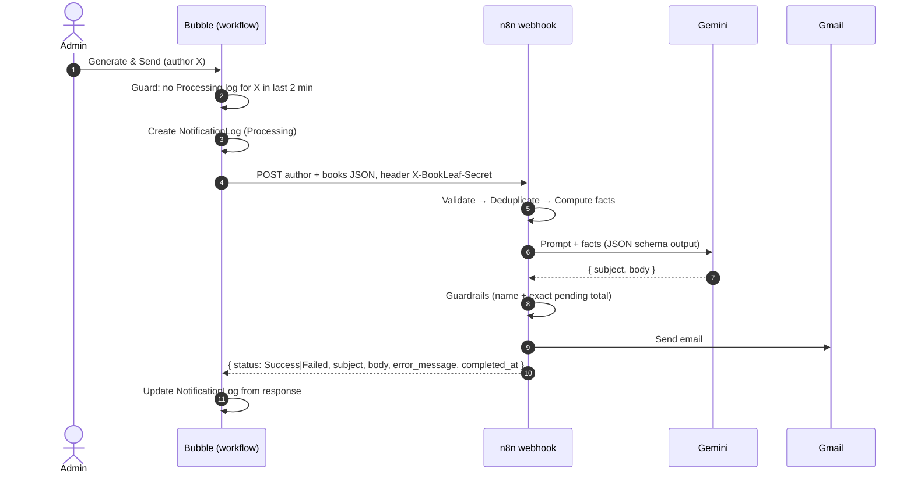

# BookLeaf: Author Royalty Dashboard & AI Notification System

Assignment 2: **Bubble.io** (application) + **n8n Cloud** (automation) + **Google Gemini** (AI email writer) + **Gmail** (delivery).

| | |
|---|---|
| Live app | https://jash2884.bubbleapps.io/version-test/ |
| Bubble editor | https://bubble.io/page?id=jash2884 (public, view-only; full collaborator access on request) |
| n8n workflow | https://jash2884.app.n8n.cloud/workflow/WVupywVRQSv814aZ (workspace invite sent to the BookLeaf team) |
| Workflow export | [`n8n/bookleaf-royalty-summary.workflow.json`](n8n/bookleaf-royalty-summary.workflow.json) |

### Test logins

| Role | Email | Password |
|---|---|---|
| Admin | `jash2884@gmail.com` | _shared separately_ |
| Author (Priya Sharma) | `priya.sharma@email.com` | _shared separately_ |
| Author (Kavita Deshmukh) | `kavita.deshmukh@email.com` | _shared separately_ |

Kavita is a useful second author to test with: one book is still in production, and her ₹850 balance is under the ₹1,000 payout threshold.

> **About emails.** The dataset's author addresses (`priya.sharma@email.com`, …) are on a real public domain, so n8n never sends to them. Every email is redirected to `jash2884@gmail.com`. The intended recipient is kept in the log and in a footer line on the email.

---

## 1. What it does

**Authors** log in and see only their own data:
- **Books:** each with title, ISBN, genre, production stage, publication date, MRP and platforms.
- **Royalty figures per book:** copies sold, earned, paid, pending and last payout date.
- **Status badge per book:** 🟢 Paid up / 🟡 Pending / 🔴 Overdue.
- **Account totals:** across all their books.

**Admins** get:
- **Author overview:** a list of all authors with totals and a payout-status badge. It can be filtered by city and payout status, and searched by name.
- **Author detail page:** books, royalties, payout history and that author's notification history. It also has:
  - the **Generate & Send Royalty Summary** button;
  - an **Author login** card that creates the author's account and links their records.
- **Bulk send:** "Send summaries to all authors with pending royalties" runs the same flow once per eligible author.
- **Notification Log:** author, status (Success / Failed / Processing / Timed out), triggered and completed times, error message, subject, and a **View email** popup showing the full AI-written email.



---

## 2. Bubble database schema

### Data types

| Type | Key fields | Why |
|---|---|---|
| **User** (built-in) | `role` (UserRole), `author` (Author) | One login type for everyone; `role` drives page access and privacy rules. Admins have no `author`. |
| **Author** | `author_code`, `name`, `email`, `phone`, `city`, `joined_date`, `user` → User, `total_books`, `total_earned`, `total_paid`, `total_pending`, `payout_status` (PayoutStatus), `last_payout_date` | The business entity. It is separate from User because authors exist before they have a login, and an author's data must not depend on an account existing. Totals are stored, not recalculated on every page load, so the admin list can filter and sort on them cheaply. |
| **Book** | `book_code`, `title`, `isbn`, `genre`, `author` → Author, `owner` → User, `stage` (ProductionStage), `publication_date`, `mrp`, `royalty_per_copy`, `copies_sold`, `royalty_earned`, `royalty_paid`, `royalty_pending`, `last_payout_date`, `print_partner`, `available_on` (list of texts), `royalty_status` (PayoutStatus) | One row per title. Books in production have empty sales fields instead of zeros pretending to be data. |
| **Payout** | `book` → Book, `author` → Author, `owner` → User, `amount`, `paid_on`, `note` | Royalty payment records, used for the payout history. The dataset only has cumulative totals and a last-payout date, so there is one Payout per paid book (its total paid to date). The type is ready for real per-transaction rows. |
| **NotificationLog** | `author` → Author, `owner` → User, `status` (NotificationStatus), `request_id`, `triggered_by` → User, `triggered_at`, `completed_at`, `is_bulk`, `recipient_email`, `email_subject`, `email_body`, `error_message` | The audit trail for every summary email, including failures, so nothing fails silently. |

### Option sets

| Option set | Values | Why an option set and not text |
|---|---|---|
| UserRole | Author, Admin | Typos are impossible, and privacy rules can compare against them. |
| ProductionStage | Manuscript Received → … → Published & Live (attribute `sort_order`) | The order is fixed and is part of the data, which lets the email say "what comes next". |
| PayoutStatus | Paid up / Pending / Overdue (attribute `color`) | One source of truth for the badge colours (`#16a34a` / `#ca8a04` / `#dc2626`). |
| NotificationStatus | Processing, Success, Failed | The log's state machine. |

### Design decisions

- **The `owner` field on Book, Payout and NotificationLog.** Bubble privacy rules work best with a direct comparison (`This Book's owner is Current User`). A chain like `This Book's author's user is Current User` gets complicated and slow. When an admin creates an author's login, the "Author login" workflow sets `owner` on all of that author's books and payouts at the same time.
- **Badge logic.** The 90-day rule from the brief:
  - **Green:** nothing pending.
  - **Yellow:** pending, but the last payout (or the publication date, if never paid) was within 90 days.
  - **Red:** pending, and that date is more than 90 days ago.

  The author-level `payout_status` is the worst of their books' statuses. The values were computed when the data was imported ([`scripts/prepare-seed.mjs`](scripts/prepare-seed.mjs)) and checked field by field against the JSON. On the import date (20 Oct 2026) every author with a pending balance is overdue under this rule. Only Farhan Sheikh is green.
- **Data import.** The 10 authors, 18 books and 12 payouts were loaded from `bookleaf_sample_data.json`. The admin overview totals were verified against values computed independently from the JSON.

### Privacy rules

"Everyone else" can see nothing on any type. Rules per type:

| Type | Rule 1 | Rule 2 |
|---|---|---|
| User | Own account (`This User is Current User`) | Admins (`Current User's role is Admin`) |
| Author | `This Author's user is Current User` | Admins |
| Book / Payout | `owner is Current User` | Admins |
| NotificationLog | — | Admins only |

**How it was tested:** logged in as Kavita (an author):
- She sees only her own 2 books and her own totals.
- Opening `/admin` or another author's `/author_detail/...` URL directly sends her back to her own dashboard.

Even if a page check were bypassed, the privacy rules mean the server never sends another author's records.

### Pages

| Page | Who | Contents |
|---|---|---|
| `index` | Everyone | Login, which sends each user to their portal by role. A first-time-setup panel can create the very first admin and then disappears; it is checked server-side and hidden once an admin exists. |
| `dashboard` | Authors | Totals, then a repeating group of books with conditional badge colours. |
| `admin` | Admins | Filters, author repeating group, bulk-send button, Notification Log with a "View email" popup. |
| `author_detail` | Admins | Profile, totals, author-login card, books, payout history, notifications, and the Generate & Send button. |

---

## 3. Bubble ↔ n8n integration

### Why the full payload goes in the webhook (brief step 2)

The brief allows either approach. Mine is: **Bubble sends the author's complete data in the webhook body, and n8n replies synchronously.** I didn't have n8n fetch the data from Bubble's Data API, for three reasons:

1. **The free plan can't do it.** It refuses all incoming API calls. Both the Data API and the Workflow API return *"This application does not expose an API. Please upgrade…"*. I confirmed this with a generated API token before choosing. A Data-API fetch or a callback from n8n into Bubble is impossible on this plan.
2. **It's better design anyway.** Bubble applies its own privacy rules when it builds the payload. n8n never needs a Bubble admin token, so there's one fewer credential that can leak.
3. **Fewer moving parts.** One request and one response, with no second round trip that could fail on its own.

**What replaces the "callback" (brief step 5).** n8n answers the original webhook request with a structured result. This uses a "Respond to Webhook" node on every branch. Bubble's API Connector receives that response, and the next workflow steps write it into the Notification Log. Every path returns the same shape:

```json
{ "status": "Success" | "Failed", "request_id": "…", "subject": "…", "body": "…",
  "recipient_email": "…", "error_message": "…", "completed_at": "2026-10-21T05:50:12Z" }
```

On a paid Bubble plan, this would switch to an asynchronous pattern: n8n responds `202` immediately and later calls a Bubble backend workflow endpoint. The Notification Log fields are already set up for that.

### The Bubble side

**API Connector** "n8n", call *Generate royalty summary*:
- Action type, POST to `https://jash2884.app.n8n.cloud/webhook/bookleaf-royalty-summary`.
- Shared header `X-BookLeaf-Secret` (private, never visible to the browser).
- "Include errors in response" is ticked, so a failed call becomes data instead of stopping the workflow.
- Body:
  ```
  { "request_id": <log's unique id>, "triggered_by": <admin email>,
    "author": { "code", "name", "email" }, "books": [ <Search for Books:format as text> ] }
  ```
  Each value is `:formatted as JSON-safe`. The book list uses `:format as text` with a JSON template per book, including `available_on` (the platform list, joined with `, `).

**Single send** (author_detail → Generate button):

| Step | Action |
|---|---|
| Only when | `Search NotificationLogs (author = this, status = Processing, triggered_at > now − 2 min) :count is 0` |
| 1 | Create NotificationLog (Processing, `triggered_by`, `triggered_at`, `recipient_email`) |
| 2 | Set `request_id` = the log's unique id |
| 3 | Call n8n |
| 4 | *Only when* the response status is "Success": Success, `completed_at`, subject, body, recipient |
| 5 | *Only when* the response status is not "Success": Failed + n8n's `error_message` |
| 6 | *Only when* step 3 `returned an error` (timeout, 5xx, 403): Failed + the HTTP error body |

**Bulk send** (admin page) is a page-side queue, because the free plan blocks outside API calls from backend workflows (see Section 6):

| Piece | What it does |
|---|---|
| Custom state `bulk_queue` (list of Authors) on the admin page | The authors still to be emailed in this run. |
| Bulk button | Sets `bulk_queue` = `Search for Authors (total_pending ≠ 0)`, then triggers **Bulk continue**. |
| Custom event **Bulk continue** | *Only when* `bulk_queue:count > 0`: triggers **Bulk send next** with `author = bulk_queue:first item`. |
| Custom event **Bulk send next** (param `author`) | Removes `author` from `bulk_queue`, then runs the same 6 steps as the single button (`is_bulk = yes`). Finally it schedules **Bulk continue** in 8 seconds. |

The two events hand off to each other because Bubble won't let a custom event schedule itself. The result is still one webhook call per eligible author, 8 seconds apart, which keeps the free Gemini tier happy. The admin watches the log fill in live. The trade-off is that the run continues only while the admin page stays open, which is acceptable for a manual "send now" button.

A backend workflow version (`send_royalty_summary`, run with *Schedule API workflow on a list*) is still in the app. That's the version I'd use on a paid plan, where backend calls aren't blocked.

### The n8n side

20 nodes in three labelled sections (sticky notes):

```
Bubble webhook ─► Validate payload ─► Payload valid? ──no──► Respond: invalid payload
                                          │yes
                                          ▼
                      Deduplicate ─► Duplicate request? ──yes──► Respond: duplicate
                                          │no
                                          ▼
          Compute royalty facts ─► Gemini: write email ──error──► Gemini: fallback model ──error──► Respond: AI unavailable
                                          │ok                              │ok
                                          ▼                                ▼
                               Parse & check AI output ─► AI output OK? ──no──► Respond: AI output rejected
                                                              │yes
                                                              ▼
                                              Send email (Gmail) ──error──► Respond: email failed
                                                              │ok
                                                              ▼
                                                      Respond: success
```

- **Validate payload** (Code): required fields, book list parsing (Bubble sends it as a JSON string), and number normalisation.
- **Deduplicate** (Code): see idempotency below.
- **Compute royalty facts** (Code): all the arithmetic and date logic. See the prompt strategy.
- **Gemini** (HTTP Request ×2): `gemini-3.5-flash`, falling back to `gemini-3.5-flash-lite`. The API key is stored as an n8n Header Auth credential.
- **Parse & check AI output** (Code): guardrails before anything is sent.
- **Send email** (Gmail node, OAuth): this is the bonus "actual email" path.

The readable source of every Code node is in [`n8n/src/`](n8n/src). [`n8n/build.cjs`](n8n/build.cjs) builds the workflow JSON from those files. The committed export is byte-for-byte identical (ignoring node IDs) to the published live workflow; I checked this by comparing hashes.

---

## 4. Prompt strategy

**Principle: the code does the maths, and the model writes the prose.** LLMs are good at tone and bad at dates and sums. So *Compute royalty facts* works out everything an email could state and passes it to the model as `<royalty_facts>` JSON. That covers:
- per-book status;
- totals (formatted as `₹13,024`);
- `fully_paid_up`, `below_threshold` and `any_overdue` flags;
- `next_payout_by` and `next_payout_covers`: quarter end + 45 days, using the previous quarter's deadline if it hasn't passed yet;
- for books in production, the current stage and the stages still to come;
- for published books, the platforms they're sold on (`available_on`).

The model is told to use only those facts, and to name a platform only if it's in that book's list.

**System prompt** ([`n8n/src/prompt.js`](n8n/src/prompt.js)) has three tagged sections:
- `<knowledge_base>`: the royalty policy from Assignment 1 (80/20 split, quarterly cycle, 45-day window, ₹1,000 threshold) and the production stages.
- `<tone>`: the Assignment 1 tone guidelines. That means empathetic and specific. An overdue payout is BookLeaf's fault, so the email apologises once and gives the "finance will confirm within 48 hours" timeline.
- `<rules>` covering every case in the brief:
  - greet by first name;
  - one line per published book;
  - account totals;
  - pending: when it will be paid, or the ₹1,000 rollover explanation if `below_threshold`;
  - fully paid: a positive acknowledgement;
  - in production: the stage and what's next, and never sales figures;
  - the exact sign-off;
  - plain text, 180–320 words.

**Output control:** Gemini is called with `responseMimeType: application/json` and a `responseJsonSchema` of `{subject, body}`. That means no fragile text parsing. The call uses `thinkingLevel: LOW` to keep it fast.

**Guardrails** before sending (*Parse & check AI output*):
- The response must have finished normally and contain valid JSON with both fields.
- The body must contain the author's first name.
- The body must contain the **exact** pending total string, e.g. `₹13,024`.
- Any sales platform the email names (Flipkart, Amazon US/UK/India, BookLeaf Store) must be one the author's books are actually listed on.

If any check fails, the email is not sent and the log shows "AI output rejected: …".

**Edge cases handled in code, not left to the model:**
- **Kavita (₹850 pending):** under the brief's 90-day rule her book is "Overdue". But policy says balances under ₹1,000 roll over, so code relabels it as *"Below ₹1,000 threshold — rolls over"*. The email therefore explains the rollover instead of apologising for a late payment. An early test email contradicted itself on exactly this, which is why the rule lives in code.
- **Never-paid authors** (Ananya, Arjun, Diya's second book): `last_payout` says "never paid yet" and the overdue reference date is the publication date.
- **Books in production** (Sneha's *Midnight in Mysore*, Kavita's *Raising Roots*): stage and next stages only.
- **Fully paid** (Farhan): `fully_paid_up: true` produces the positive acknowledgement.

**Prompt iteration (from local testing).** [`scripts/test-n8n-code.cjs`](scripts/test-n8n-code.cjs) runs the real Code-node scripts locally against Gemini, with n8n's globals stubbed out. Early outputs:
- used bullet characters;
- invented "progress" claims for books in production;
- contradicted themselves on the threshold case;
- named platforms the author's book isn't sold on (Farhan's email mentioned "Amazon and Flipkart").

Each problem became an explicit rule, a code-level fact, or a guardrail. For the platform case, all three: Bubble now sends each book's platforms, the prompt only allows those, and *Parse & check* rejects any email naming another store.

**Real outputs** (from n8n executions):

<details><summary>Rohit Kapoor: overdue, two books</summary>

```
Subject: Your BookLeaf royalty summary — ₹13,024 pending

Dear Rohit,

Here is your royalty summary as of 20 October 2026.

Code & Karma: 876 copies sold. Total royalty earned is ₹26,280, with ₹21,000 paid and ₹5,280 pending.
Startup Sutra: 1,203 copies sold. Total royalty earned is ₹57,744, with ₹50,000 paid and ₹7,744 pending.

Account Totals:
Total Earned: ₹84,024
Total Paid: ₹71,000
Total Pending: ₹13,024

Your pending payout of ₹13,024 is currently overdue. This delay is entirely on our end, and we sincerely
apologise for this lapse. Under our standard policy, royalties are calculated quarterly and paid within
45 days of the quarter ending via bank transfer. Our finance team will confirm your exact payout date
within 48 hours.

Please check your author dashboard to ensure your linked bank details are up to date.

Warm regards,
The BookLeaf Author Support Team
```
</details>

<details><summary>Farhan Sheikh: fully paid up (after the platform fix)</summary>

```
Subject: Your BookLeaf royalty summary — Fully paid up

Dear Farhan,

Here is a summary of your royalties and book performance as of 21 October 2026.

For Ghazal of the Forgotten, published on 26 January 2024, you have sold 156 copies on Amazon India and
BookLeaf Store. The total royalty earned is ₹3,120, with ₹3,120 paid and ₹0 pending.

Across your account, your total earned royalty is ₹3,120, total paid is ₹3,120, and total pending is ₹0.

Thank you for publishing with us. Your account is currently fully paid up, and there are no outstanding
royalties pending for payout.

You can always check your dashboard for a per-platform royalty breakdown.

Warm regards,
The BookLeaf Author Support Team
```
</details>

**Known weakness I'd fix next:** overdue emails sometimes rely only on the 48-hour finance follow-up and don't state `next_payout_by`. That's arguably right for overdue balances, but the rule could be explicit about which to use.

---

## 5. Error handling

| Failure | What happens | What the admin sees |
|---|---|---|
| Missing or wrong webhook secret | n8n's Header Auth rejects with **403** before any node runs | Log → **Failed** (Bubble step 6, HTTP error) |
| Malformed payload | *Validate* → `Respond: invalid payload` | **Failed**: "books must be a list; …" |
| Primary model fails (503 overload, 429, 20 s timeout) | Error output → **fallback model**, no waiting retry | Nothing, if the fallback works |
| Both models fail | `Respond: AI unavailable` with the API's error message | **Failed**: "AI service unavailable …" |
| Model output malformed or fails guardrails (name, pending total, platforms) | Not sent; `Respond: AI output rejected` | **Failed** with the reason |
| Gmail send fails | `Respond: email failed`; subject and body are still returned | **Failed**, but the email text is visible in the log |
| n8n unreachable, 5xx, or timeout | API Connector `returned an error` (errors are included in the response) | **Failed** with the HTTP error |
| Bubble's workflow dies mid-run (e.g. a free-plan limit) | The log stays Processing | After 2 minutes it shows **Timed out** in red, so it never hangs forever |

**No endless spinner.** While a summary is Processing, the Generate button reads "Generating…" and is disabled. Every outcome ends Processing, and anything stuck past 2 minutes is shown as Timed out. Timeouts were picked to fit inside Bubble's API call limit: 20 s per model call, at most 2 calls.

### Idempotency (two layers)

1. **Bubble:** the Generate workflow only runs if the author has no Processing log from the last 2 minutes, and the button is disabled meanwhile. A double click creates one log, not two.
2. **n8n:** *Deduplicate* keeps `{author_code → request_id, time}` in workflow static data. A **different** request for the same author within 120 seconds is answered as a duplicate (Failed, `duplicate: true`) without calling the AI or sending email. A retry of the **same** `request_id` goes through. Tested by sending two requests 1 second apart.

### Webhook security
- **Shared secret:** a 48-hex-character secret in header `X-BookLeaf-Secret`. It is checked by n8n's Header Auth credential, and in Bubble it's a private API Connector header that never reaches the browser.
- **API keys:** the Gemini key is an n8n credential, and Gmail uses OAuth, so no password is stored anywhere.
- **Nothing in the repo:** the workflow JSON references credentials by ID only.

---

## 6. Challenges and the learning process

I hadn't built in Bubble before this. How it went:

**Learning the model before building.**
- Worked through the Bubble manual sections on data types, privacy rules, the API Connector and backend workflows.
- The useful mental model: **pages are views, the database plus privacy rules are the real security boundary, and workflows are event → ordered actions with "Only when" conditions.**
- Designed the schema on paper first, the way I would in Postgres for Assignment 1, then mapped each relation to a Bubble "thing" field.
- Used Bubble's AI agent to scaffold the data types, records and first page layouts from a precise spec, then checked and rebuilt the workflows by hand. I wanted to understand every step, and the agent's credits ran out partway, which settled it.

**Things that surprised me and how I worked around them:**

| Challenge | Resolution |
|---|---|
| **Free plan blocks all incoming API calls.** I'd planned for n8n to read from the Bubble Data API and call back into a backend workflow. | Tested it with a real token and got "This application does not expose an API". Redesigned to send the full data in the webhook plus a synchronous response (Section 3). |
| **"Workflow limit available on the Free plan"** when bulk-sending through a backend workflow. The first run sent 4 of 9; on the next two days no backend call left Bubble at all, while single sends from the page kept working. | Found the error in Bubble's server logs. The conclusion was that on the free plan, backend (scheduled) workflows can't reliably call outside APIs. I rebuilt bulk send as a page-side queue (custom state + two custom events, Section 3). Its first run sent all 9 summaries successfully. The stuck runs are also why I added the **Timed out** state. |
| The API Connector won't let you use a call in a workflow until it's **initialised**, and the response fields only exist after that. | Initialised it with a real sample author so Bubble learnt the response shape, then built the steps that read `Result of step 3's body's status`. |
| Building JSON in Bubble: quotes in book titles (*Durga's Daughters*) broke the payload. | `:formatted as JSON-safe` on every dynamic value. The book list uses `:format as text` with a JSON template. On the n8n side, *Validate* accepts the list either as a JSON string or as an array. |
| Date maths in conditions ("older than 2 minutes"). Bubble only allows the operator on the left side of a comparison. | Wrote it as `triggered_at + minutes: 2 < Current date/time` instead of `now − 2 min`. |
| Reusing the 6-step workflow for bulk sends. | Bubble lets you copy and paste actions between workflows, but references (`Current page's Author`, `Result of step N`) break and must be re-pointed: to the event's `author` parameter, and to the new step numbers. Pasting also needs an existing action to paste after. |
| A custom event can't schedule itself (Bubble hides it from the list to prevent loops). | Two events that hand off to each other: *Bulk send next* schedules *Bulk continue* in 8 s, and *Bulk continue* triggers *Bulk send next* while the queue isn't empty. |
| Gmail app passwords aren't available on this Google account, so SMTP was impossible. | Switched the n8n node to the Gmail API with OAuth. That's more secure too, since no password is stored. |
| Gemini free tier: frequent 503s and a 39 s run with retries enabled. | Removed the retry and added a fallback model with 20 s timeouts. |

**What I'd do with more time or a paid plan:**
- An async callback (202 now, then a backend endpoint), and the backend bulk workflow, so a bulk run doesn't depend on the admin's browser staying open.
- Recompute badge statuses with a daily scheduled backend workflow, instead of storing them at import.
- A batch ID on bulk-send log entries, so one bulk run can be viewed as a group.

---

## Repository layout

```
n8n/
  bookleaf-royalty-summary.workflow.json   ← deliverable (import into n8n)
  build.cjs                                ← builds the JSON from src/
  src/                                     ← readable Code-node sources + system prompt
scripts/
  prepare-seed.mjs     ← computes derived fields for the Bubble import (badges, totals)
  test-n8n-code.cjs    ← runs the Code-node pipeline + Gemini locally
data/
  bookleaf_sample_data.json, seed-computed.json, agent-seed-prompt.txt
```

**Importing the workflow:** in n8n, go to *Workflows → Import from file*. Then create three credentials and select them on the matching nodes:
- Header Auth `X-BookLeaf-Secret` for the webhook;
- Header Auth `x-goog-api-key` for both Gemini nodes;
- Gmail OAuth2 for the email node.

Then publish.

### API keys and placeholders

The export contains **no API keys or secrets**. Each node points to a credential by name and ID only. The values live in n8n's encrypted credential store, so after importing, those nodes show a missing credential until you create your own. Where each value goes:

| Placeholder | Where it goes | What to put there |
|---|---|---|
| `YOUR_WEBHOOK_SECRET` | n8n: Header Auth credential on **Bubble webhook** (name `X-BookLeaf-Secret`). Bubble: API Connector → n8n call → private header `X-BookLeaf-Secret` | Any long random string, the same in both places |
| `YOUR_GEMINI_API_KEY` | n8n: Header Auth credential on **Gemini: write email** and **Gemini: fallback model** (name `x-goog-api-key`) | A key from Google AI Studio |
| Gmail account | n8n: Gmail OAuth2 credential on **Send email (Gmail)** | Sign in with the sending Google account |
| Safe recipient | `SAFE_RECIPIENT` in [`n8n/src/facts.js`](n8n/src/facts.js) (and the matching Code node) | The inbox that receives every test email |

The local test script reads the Gemini key from the environment: `GEMINI_API_KEY=YOUR_GEMINI_API_KEY node scripts/test-n8n-code.cjs AUTH002`.
